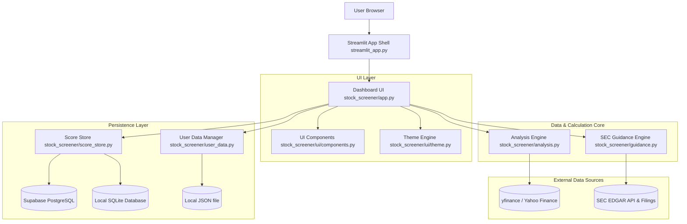

# Project Capabilities Audit Report

**Project:** AI Stock Analyst – Equity Research Platform & Screener  
**Repository:** `stock-screener`  
**Audit Date:** November 2026  
**Auditor:** Zoo (Architect)  

---

## Executive Summary

This report presents an architectural and functional capabilities audit of the **Stock Screener** repository. The codebase was evaluated against the project specifications set forth in [`docs/PRD.md`](docs/PRD.md:1) and the implemented codebase structure under [`stock_screener/`](stock_screener/app.py:1).

The project is a fully functioning, interactive equity-research platform implemented in Python using **Streamlit**. It provides institutional-grade fundamental equity analysis, rule-based quantitative scoring, custom DCF valuation modeling, SEC EDGAR numeric guidance extraction, 7-indicator screening, relative heatmaps against permanent cross-sector benchmarks, persistent score archiving via Supabase/SQLite, and local user portfolio/watchlist management.

---

## 1. System Architecture Overview

The system follows a modular architecture separating presentation, data retrieval, calculation/modeling, SEC extraction, persistence, and local user state management.



### Key Modules and Responsibilities

1. **[`streamlit_app.py`](streamlit_app.py:1)**: Main entry point for Streamlit application execution.
2. **[`stock_screener/app.py`](stock_screener/app.py:1)**: Central Streamlit dashboard UI controlling routing, page layout, user filters, valuation sliders, heatmaps, and charts.
3. **[`stock_screener/analysis.py`](stock_screener/analysis.py:1)**: Core market data processing engine. Handles yfinance data fetching, fundamental statement parsing, metric calculations (margins, ROE, debt leverage, FCF yields, CAGRs), DCF modeling, WACC & terminal growth sensitivity, reverse DCF growth gap, 7-indicator compilation, technical analysis (SMA, RSI, MACD), and scorecard weighting.
4. **[`stock_screener/guidance.py`](stock_screener/guidance.py:1)**: Official SEC EDGAR filing discovery engine. Scans recent 8-K/6-K exhibits for numeric company guidance, extracts evidence sentences, maps fiscal periods, checks historical guidance accuracy, and formats document source links.
5. **[`stock_screener/score_store.py`](stock_screener/score_store.py:1)**: Score persistence layer. Manages daily UTC snapshots of analyzed company scores in a remote Supabase PostgreSQL database (configured via [`supabase/score_history.sql`](supabase/score_history.sql:1)) or a local SQLite database fallback (`~/.stock-screener/score_history.sqlite3`).
6. **[`stock_screener/user_data.py`](stock_screener/user_data.py:1)**: Manages persistent local user preferences, watchlists, and manual portfolio positions in `~/.stock-screener/user_data.json`.
7. **[`stock_screener/ui/components.py`](stock_screener/ui/components.py:1)** & **[`stock_screener/ui/theme.py`](stock_screener/ui/theme.py:1)**: Reusable layout headers, styling tokens, dark/light theme options, and custom CSS styling.

---

## 2. Feature & Capabilities Audit Matrix

| Feature Area | PRD Requirement | Implementation Status | Implementation Details / File References |
|---|---|---|---|
| **Global Stock Search** | Search US, European, Indian, Japanese tickers with exchange suffixes | **Fully Implemented** | Ticker validation and regex checking in [`stock_screener/analysis.py:validate_ticker`](stock_screener/analysis.py:19); market data via yfinance. |
| **Permanent Benchmarks** | Side-by-side comparison with MSFT, GOOGL, META, AAPL | **Fully Implemented** | Defined as `BENCHMARKS` constant in [`stock_screener/analysis.py:16`](stock_screener/analysis.py:16). Heatmap tables generated in [`stock_screener/app.py:_build_comparison`](stock_screener/app.py:423). |
| **7-Shade Heatmap** | Color-coded relative ranking for comparison metrics | **Fully Implemented** | Custom red-to-yellow-to-green palette `HEATMAP_COLORS` in [`stock_screener/app.py:_heatmap_table`](stock_screener/app.py:356). |
| **7 Investment Indicators** | Growth, margins, moat proxy, financial health, valuation, management, momentum | **Fully Implemented** | Function [`stock_screener/app.py:_build_seven_indicator_comparison`](stock_screener/app.py:583) compiles all 7 criteria with category filters. |
| **Discounted Cash Flow (DCF)** | Standard DCF, Normalized DCF, WACC/terminal growth sensitivity | **Fully Implemented** | Built-in forecast DCF [`stock_screener/analysis.py:calculate_forecast_dcf`](stock_screener/analysis.py:1), normalized DCF starting FCF override, and 5 scenario presets in [`stock_screener/app.py:934`](stock_screener/app.py:934). |
| **DCF Confidence Score** | Evaluate assumption reliability & sensitivity | **Fully Implemented** | Rule-based scoring in [`stock_screener/analysis.py:dcf_confidence`](stock_screener/analysis.py:1) evaluating FCF volatility, sensitivity, terminal value share, and guidance accuracy. |
| **SEC Guidance Extraction** | Retrieve official filing guidance and evidence | **Fully Implemented** | Regex & HTML parser engine in [`stock_screener/guidance.py:fetch_official_guidance`](stock_screener/guidance.py:1) scanning EDGAR filings with exhibit links and sentence evidence. |
| **Technical Analysis** | SMAs (50, 200), RSI (14), MACD, Max Drawdown | **Fully Implemented** | Indicator calculation function [`stock_screener/analysis.py:technical_indicators`](stock_screener/analysis.py:1) and interactive line charts in [`stock_screener/app.py:1458`](stock_screener/app.py:1458). |
| **Score History & Archiving** | Record daily ticker score snapshots across users | **Fully Implemented** | Supabase REST API & local SQLite archive in [`stock_screener/score_store.py`](stock_screener/score_store.py:1). SQL schema in [`supabase/score_history.sql`](supabase/score_history.sql:1). |
| **User Workspace** | Watchlist, Portfolio positions, theme toggle | **Fully Implemented** | JSON persistence in [`stock_screener/user_data.py`](stock_screener/user_data.py:1) storing watchlist, portfolio cost basis, and UI theme. |
| **CSV Export** | Export comparison data to CSV | **Fully Implemented** | Download button for formatted CSV exports in [`stock_screener/app.py:1523`](stock_screener/app.py:1523). |
| **AI LLM Research Engine** | OpenAI API for qualitative synthesis, news sentiment, moat scoring | **Rule-based Implementation** | The project strictly avoids AI hallucinations by implementing rule-based quantitative models without active OpenAI API calls. |
| **Licensed Analyst Estimates** | Real-time consensus analyst price targets and estimates | **Not Configured** | Marked as `Unavailable` in UI as specified by design when no licensed data provider is configured. |
| **Tech Stack Architecture** | PRD specified Next.js + React + FastAPI | **Streamlit Single-Stack** | Built entirely using Python Streamlit, which accelerates development and provides interactive UI components natively. |

---

## 3. Financial Analysis & Calculation Engine Capabilities

The calculation engine in [`stock_screener/analysis.py`](stock_screener/analysis.py:1) provides quantitative rigour:

1. **Financial Metrics Calculation**:
   - CAGRs: 3-year and 5-year compound annual growth rates for revenue.
   - Profitability Ratios: Gross margin, operating margin, EBITDA margin, net profit margin, Return on Equity (ROE), Return on Assets (ROA).
   - Cash Flow Ratios: Free cash flow ($FCF = OCF - Capex$), FCF margin, FCF conversion ($FCF / Net Income$).
   - Capital Structure & Liquidity: Net Debt ($Debt - Cash$), Net Debt / EBITDA, Current Ratio.

2. **Valuation Engine**:
   - **Forecast DCF**: Multi-year forecast built from reported financial statements, SEC guidance, and editable model growth rates.
   - **Normalized DCF**: Uses median historical revenue, operating cash flow margin, and capex intensity over 3+ years to smooth cyclical spikes.
   - **Reverse DCF**: Computes the market-implied FCF growth rate necessary to justify the current Enterprise Value.
   - **Comparable EV/EBITDA**: Peer-based valuation using median peer multiples (e.g., specialized handling for Micron technology peers `000660.KS` and `005930.KS`).
   - **Scenario Analysis**: Five presets (Bear, Conservative, Base, Bull, Extreme Bull) with editable annual FCF/revenue growth schedules, WACC, and terminal growth.

3. **Quantitative Scoring & Ratings**:
   - Score dimensions: Business Quality (15%), Financial Health (15%), Moat Proxy (15%), Growth (20%), Valuation (20%), Technical Strength (5%), Risk (10% deduction).
   - Rule-based investment rating output: `STRONG BUY`, `BUY`, `HOLD`, `SELL`, `STRONG SELL`.

---

## 4. Test Coverage Audit

The project includes comprehensive unit tests under [`tests/`](tests/test_stock_analysis.py:1):

- **[`tests/test_stock_analysis.py`](tests/test_stock_analysis.py:1)**: Verifies ticker validation, financial ratio formulas, DCF calculations, WACC sensitivity, reverse DCF growth gap, 7-indicator generation, technical indicators, and scorecard weightings.
- **[`tests/test_score_store.py`](tests/test_score_store.py:1)**: Tests Supabase REST integration, local SQLite fallback creation, daily snapshot insertion, and error handling.
- **[`tests/test_user_data.py`](tests/test_user_data.py:1)**: Validates local JSON loading, schema migration, default creation, watchlist additions, and portfolio cost basis tracking.

To execute tests:
```powershell
python -m unittest discover -s tests -v
```

---

## 5. Key Strengths & Comparative Advantages

1. **Data Integrity & Provenance**: Financial metrics are strictly calculated programmatically from verified financial statement data (`yfinance`) and SEC EDGAR filings, avoiding AI hallucination risks.
2. **SEC EDGAR Integration**: Automated extraction of numeric guidance with exact sentence evidence, filing timestamps, document links, and historical guidance accuracy tracking.
3. **Transparent DCF Modeling**: Every DCF assumption (growth rate, WACC, terminal growth, tax rate, capex intensity) is editable by the user in real time.
4. **Resilient Dual Storage**: Daily score snapshots support both cloud Supabase PostgreSQL and local SQLite databases without vendor lock-in.
5. **Interactive Relative Heatmaps**: Color-coded relative metrics across target stock, 4 cross-sector benchmarks, and custom industry peers.

---

## 6. Recommendations & Future Roadmap

1. **AI Qualitative Synthesis (Phase 2 PRD Compliance)**:
   - Introduce an optional LLM service (e.g. via OpenAI API or Anthropic API) to summarize qualitative SEC risk factors (Item 1A) and recent news headlines without altering quantitative financial figures.
2. **Expanded Regulatory Filing Coverage**:
   - Extend guidance parsing beyond US SEC EDGAR to European regulators (ESMA/EDGAR equivalents) and Indian exchange filings (NSE/BSE announcements).
3. **Export Capabilities (PDF / Excel)**:
   - Add PDF report generation using `reportlab` or `weasyprint`, enabling downloadable executive summary packages for off-line research.
4. **Performance & Caching Optimizations**:
   - Expand `st.cache_data` TTL strategies and pre-fetch market quotes for faster sidebar ticker switching.

---

*Report prepared by Zoo (Architect Mode).*
